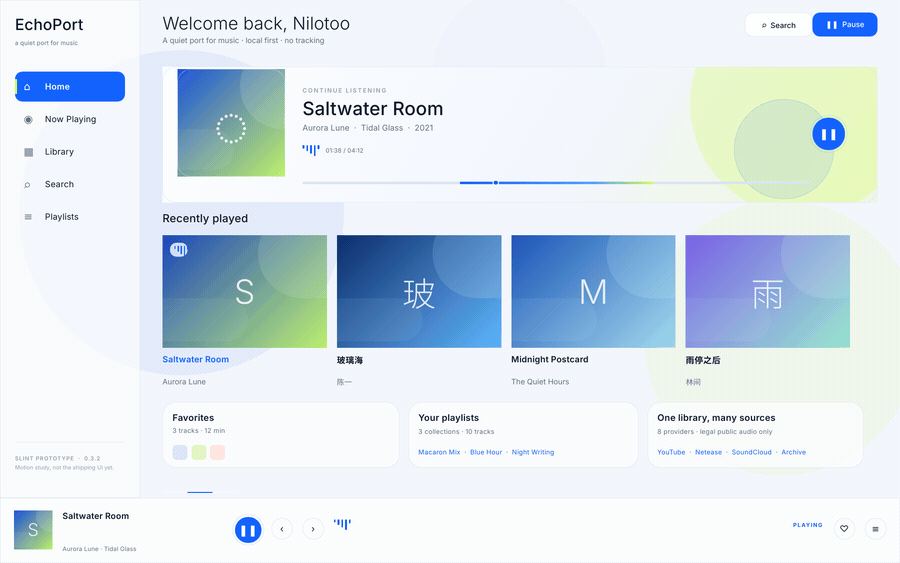
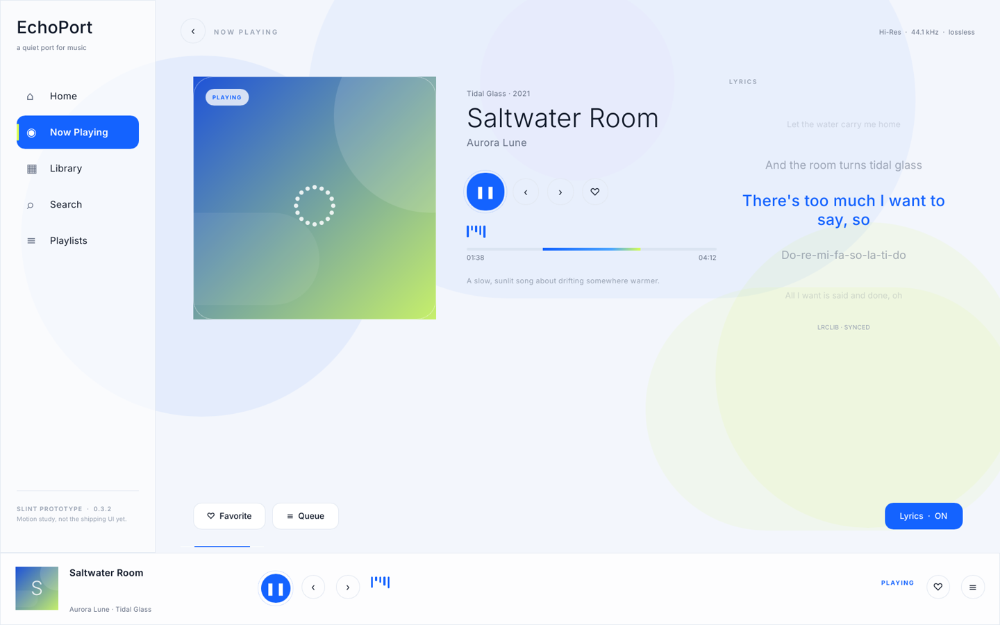
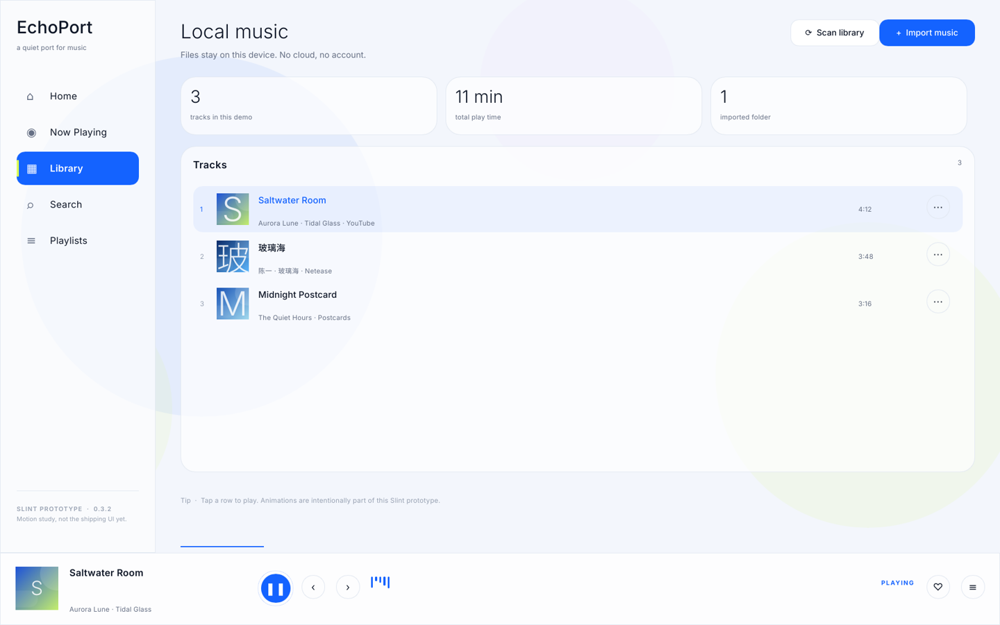

# EchoPort · Slint motion lab

A standalone Slint prototype exploring a more animated EchoPort UI. It is a
visual study only: the controls are local state and the data is mocked. The
shipping egui app remains untouched in the repository root.







## Run

```sh
cd prototype/slint
cargo run --release
```

On a machine without a usable GPU/GL driver, force the software renderer:

```sh
SLINT_BACKEND=winit-software cargo run --release
```

Switch pages from the left rail, or click the hero / album cards to slide to
Now Playing. The page strip slides horizontally; the player, equalizer, ambient
blobs, floating artwork, breathing play ring, progress and lyrics run from a
shared 80 ms clock.

## What the motion study covers

- sliding page strip with a spring-like cubic-bezier;
- slowly drifting ambient color fields;
- floating hero/now-playing artwork;
- breathing play/pause ring and animated equalizer bars;
- hover elevation, border highlights and nav selection transitions;
- lyric line rotation, size/colour/opacity transitions;
- continuously moving progress bar and animated cover details;
- modal-free, single-window layout with a persistent player.

## Screenshot harness

The prototype can render itself off-screen for documentation:

```sh
SLINT_BACKEND=winit-software \
SLINT_SHOT_PAGE=1 \
SLINT_SHOT=$PWD/preview/now-playing.png \
cargo run --release
```

`SLINT_SHOT_PAGE`: `0` Home, `1` Now Playing, `2` Library.

## Scope / next steps

This is **not** a feature migration. To move the real app to Slint we still need:

1. extract a UI-agnostic controller/state loop from the current egui app;
2. reconnect the audio engine, store, providers, downloads and lyrics;
3. port the remaining pages and dialogs;
4. rebuild Android on Slint's Gradle + `android-activity` path (paused for now);
5. decide whether Slint's GPL-3.0-compatible community license is acceptable for
   distribution.

The current egui app is deliberately kept as the fallback and shipping UI.

## License

Prototype code follows the repository's GPL-3.0-only license. Slint is used
under its GPL-3.0-compatible community license for this prototype.
